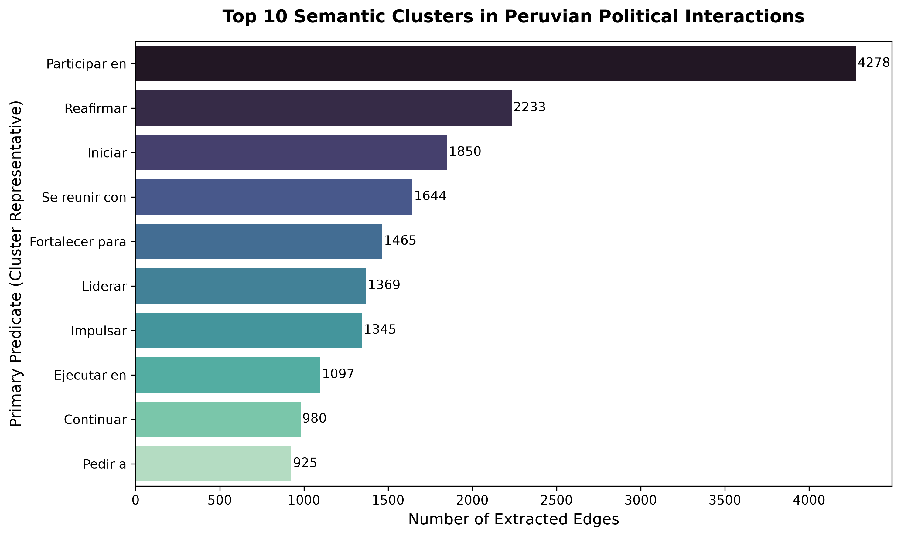
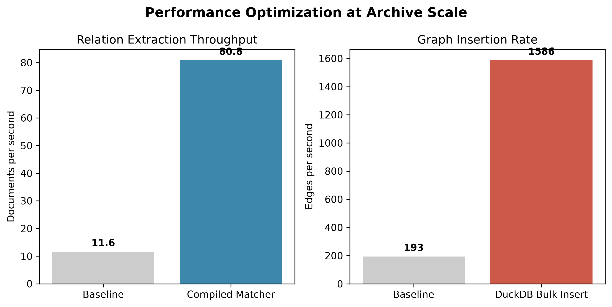
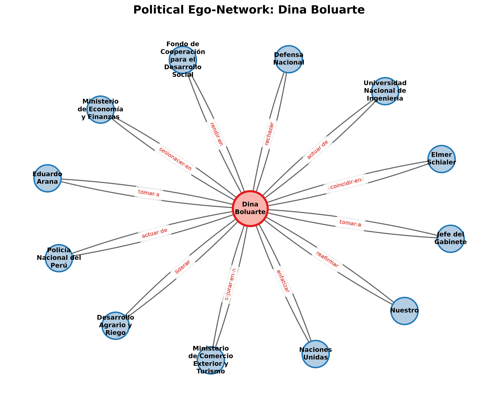

# Grafo Temporal de Relaciones Políticas del Perú

Sistema de procesamiento de lenguaje natural (PLN) que convierte un archivo de **50,000 noticias** de la Agencia Andina en un **grafo de conocimiento temporal** de actores políticos peruanos (2021–2026). En lugar de forzar las interacciones en categorías predefinidas como "apoya" o "ataca", extrae los verbos tal como aparecen en el texto y los agrupa en familias de relaciones mediante clustering semántico. El resultado se explora en una aplicación web interactiva que muestra cómo cambian las alianzas y quiénes son los actores centrales en cada periodo. Proyecto académico desarrollado en un equipo de 5 personas.

---

## Capturas


| Centralidad de actores | Ego-network de un actor |
|---|---|
|  |  |

---

## Tecnologías Utilizadas

**Lenguaje y entorno:** Python 3.13, uv

**PLN y machine learning:** spaCy (análisis de dependencias), Transformers (BETO para NER), sentence-transformers (`paraphrase-multilingual-MiniLM-L12-v2`), clustering aglomerativo, PyTorch (CUDA)

**LLMs:** capa agnóstica de proveedor (Anthropic, OpenAI, Groq, Gemini) con salida estructurada validada con Pydantic

**Datos y grafos:** DuckDB, NetworkX (PageRank, comunidades de Louvain, caminos mínimos), Parquet

**Backend:** FastAPI

**Frontend:** Cytoscape.js, JavaScript

**Ingesta:** Requests, BeautifulSoup (lxml)

---

## Características

- **Grafo temporal de actores políticos:** personas y organizaciones conectadas por relaciones fechadas, construido a partir de 1.98 millones de menciones de entidades y 71,396 relaciones extraídas.
- **Relaciones abiertas, no categorías rígidas:** el sistema extrae el verbo que conecta a dos actores ("lidera", "rechaza", "se reúne con") a partir del árbol sintáctico de la oración.
- **453 familias de relaciones inducidas automáticamente** a partir de 6,673 predicados distintos, sin una taxonomía definida de antemano.
- **Análisis de redes:** centralidad (PageRank) para identificar actores con poder de convocatoria, detección de facciones (comunidades de Louvain) y caminos mínimos entre actores.
- **Dos vistas en la aplicación web:** el grafo completo de un tema y una cronología por actor (ego-network), para seguir su evolución en el tiempo.
- **Líneas de tiempo de figuras políticas con LLMs:** generación de resúmenes de eventos anclados únicamente en los pasajes de las noticias (RAG), comparada contra baselines extractivos y contra una versión sin anclaje para medir alucinaciones.

---

## El Proceso

**Ingesta del corpus.** El buscador de la Agencia Andina limita cada consulta a unos 300 resultados, así que construimos un crawler que recorre las noticias por ID, con límite de 2 solicitudes por segundo, reintentos con espera exponencial y checkpoints para reanudar. Al limpiar el HTML eliminamos también las firmas de los periodistas (por ejemplo, "(FIN) NDP/JCR"), porque el modelo de NER confundía esas iniciales con organizaciones.

**Reconocimiento y resolución de entidades.** Un mismo político aparece con muchos nombres ("Pedro Castillo", "P. Castillo", "presidente Castillo"). Comparar todas las menciones entre sí era inviable, así que usamos *blocking* con un índice invertido de tokens: solo se comparan los grupos que comparten alguna palabra. Para decidir si dos nombres son la misma entidad usamos un **ratio de contención** (palabras en común dividido entre el nombre más corto) con un umbral de 0.7, en lugar de la similitud de Jaccard, que separaba "Partido Nacionalista" de "Partido Nacionalista Peruano".

**Extracción de relaciones.** Para cada par de entidades que aparecen en la misma oración, el sistema busca el verbo que las conecta en el árbol de dependencias. Si no hay un verbo explícito, la relación se descarta: priorizamos precisión sobre cobertura, porque que dos actores aparezcan juntos no significa que estén relacionados.

**Clustering semántico.** En vez de agrupar las 71,396 relaciones, agrupamos solo los 6,673 predicados únicos, lo que reduce drásticamente el costo. Cada predicado se convierte en un embedding dentro de una plantilla neutral ("ENT_A [predicado] ENT_B") y se agrupa con clustering aglomerativo por distancia coseno.

**Rendimiento.** Dos optimizaciones hicieron viable procesar todo el archivo: un *matcher* compilado de patrones sintácticos multiplicó por 7 la velocidad de extracción, y la inserción masiva en DuckDB multiplicó por 8 la velocidad de construcción del grafo. Guardar las 71,396 relaciones pasó de más de 6 minutos a 45 segundos.

**Aplicación web.** La API en FastAPI solo lee resultados precalculados: no ejecuta modelos ni llama a LLMs durante una solicitud. El frontend carga primero la estructura del grafo y pide los pasajes de evidencia de cada relación recién cuando el usuario la selecciona, para no saturar la memoria del navegador.

---

## Resultados

| Métrica | Resultado |
|---|---|
| Noticias procesadas | 50,000 |
| Menciones de entidades | 1,983,499 |
| Relaciones fechadas en el grafo | 71,396 |
| Familias de relaciones inducidas | 453 (a partir de 6,673 predicados) |
| Resolución de entidades | Precisión de 0.71, recall de 0.83 |
| Velocidad de extracción | De 11.6 a 80.8 documentos por segundo (7×) |
| Velocidad de inserción en el grafo | De 193 a 1,586 relaciones por segundo (8×) |

| Familias de relaciones más frecuentes | Optimización de rendimiento |
|---|---|
|  |  |

<details>
<summary><b>Ver ejemplo de ego-network</b></summary>



</details>

El detalle de la metodología y la evaluación está en el [paper del proyecto](docs/PLN_ConsultadePerfiles-Paper.pdf).

---

## Lo Que Aprendí

Aprendí a diseñar un pipeline de PLN que escala a millones de menciones priorizando decisiones algorítmicas (blocking, clustering sobre predicados únicos, inserción masiva) antes que más hardware, y a evaluar con métricas propias cuándo un LLM aporta y cuándo alucina.

---

## Cómo Puede Mejorarse

- **Resolución de correferencias:** cuando un actor se menciona solo por su cargo ("el ministro de Economía"), hoy queda como un nodo separado o se pierde la relación.
- **Fuentes más diversas:** el corpus es de una agencia estatal; sumar otros medios reduciría el sesgo en la representación de la oposición.
- **Pruebas automatizadas y CI:** hoy la verificación se hace con scripts manuales; un conjunto de pruebas con `pytest` haría más seguros los cambios en el pipeline.

---

## Cómo Correr el Proyecto

### Requisitos
- Python `>=3.12,<3.14` y [uv](https://docs.astral.sh/uv/)
- Modelo de spaCy `es_core_news_md`

### Instalación

```bash
uv sync
uv run python -m spacy download es_core_news_md
```

Para usar LLMs, copia `.env.example` a `.env` y agrega la API key del proveedor. El grafo y los flujos sin LLM no la necesitan.

### Abrir la aplicación web

Los resultados ya precalculados están versionados en `data/`, así que no hace falta reprocesar nada:

```bash
uv run uvicorn src.app.api:app --reload
```

Abre `http://127.0.0.1:8000`.

### Construir un grafo desde cero

```bash
uv run python scripts/build_open_graph.py andina-mar-may-2026 \
  --jsonl data/andina_crawl.jsonl \
  --top-n 300 \
  --inicio 03-2026 \
  --fin 05-2026
```

La guía técnica completa (crawler, generación de cronologías, variables de entorno y evaluación) está en [docs/guia-tecnica.md](docs/guia-tecnica.md).
